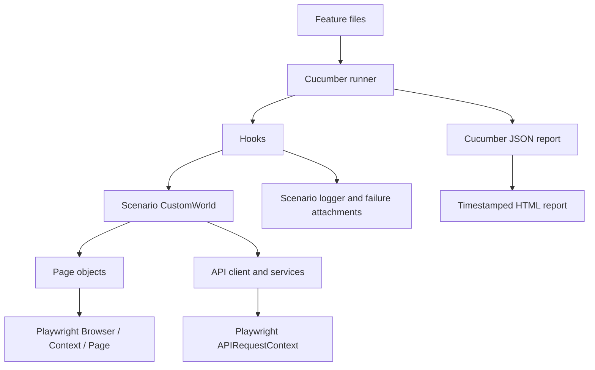

# Enterprise Playwright + Cucumber Automation

A TypeScript automation starter for browser journeys and REST APIs. It uses
Playwright for browser and HTTP capabilities, Cucumber for Gherkin scenarios,
scenario-scoped World state, reusable page/service objects, JSON + HTML reports,
and GitHub Actions.

> The UI examples use SauceDemo, a public demonstration store. Checkout only
> exercises its demo flow; it does not submit a real payment. The API examples
> use JSONPlaceholder, whose writes are simulated rather than persisted.

## Architecture and execution flow



Each Cucumber scenario gets a new `CustomWorld`, API request context, and
browser context; `@ui` scenarios additionally get a page. The browser process is managed once per Cucumber
worker. The `After` hook attaches a screenshot and failure text when available,
then disposes the API context and closes the scenario browser context. Cucumber
parallel workers are separate processes, so browser managers and World state
are not shared between workers.

`Browser` is the launched browser process; `BrowserContext` isolates cookies,
permissions, and storage for a scenario; `Page` is a tab; `StorageState` is a
snapshot of cookies and local storage used to seed a context.

## Folder structure

```text
config/                 Environment and Cucumber configuration
playwright.config.ts    Shared browser, worker, screenshot, and report settings
src/
  api/                  HTTP client, user service, models, response helpers
  constants/             Shared selectors/constants
  core/                  Browser lifecycle, hooks, World, session state
  features/              UI and API Gherkin
  pages/                 POM page objects
  step-definitions/      Cucumber glue, grouped by UI/API
  utils/                 Logging, waits, and generated test data
scripts/                 Cleanup and report utilities
.github/workflows/       CI workflows
test-data/               Versioned, non-secret JSON fixtures validated at load time
reports/                 Generated JSON and timestamped HTML reports
```

## Prerequisites and installation

- Node.js 22 or later (CI uses Node 22)
- npm
- Playwright browser binaries for the browser(s) you intend to run

```powershell
npm ci
npx playwright install chromium
Copy-Item .env.example .env
```

Install the browser binaries you intend to run with
`npx playwright install chromium firefox webkit`.

## Environment configuration

`TEST_ENV` selects `qa`, `staging`, or `production`; the corresponding file under
`config/env/` supplies non-secret URL configuration. The QA profile defaults to
the public demo services; staging and production deliberately require explicit
`APP_BASE_URL` and `API_BASE_URL` values to avoid accidentally targeting the QA
demo. `.env` overrides `.env.example`, and the process environment overrides
both. `.env.example` may contain only non-secret demo credentials; keep real
account credentials in `.env` or your CI secret store, and never commit them.

Set `UI_USERNAME` and `UI_PASSWORD` in `.env` or `.env.example` to the
credentials provided by the demo site/account you are authorized to use. The
example file is loaded only as a fallback when a value is not set in `.env` or
the process environment. UI login steps fail explicitly if either value is
missing. `INVALID_UI_USERNAME` is only used for the negative login scenario.

| Variable | Default | Purpose |
| --- | --- | --- |
| `TEST_ENV` | `qa` | Select environment defaults |
| `APP_BASE_URL` | SauceDemo URL | UI base URL |
| `API_BASE_URL` | JSONPlaceholder URL | API base URL |
| `BROWSER` | `chromium` | `chromium`, `firefox`, `webkit`, or `all` |
| `HEADLESS` | `true` | Set `false` for headed UI |
| `WORKERS` | `1` | Cucumber parallel worker count |
| `UI_USERNAME`, `UI_PASSWORD` | unset | Required for UI login tests |
| `REUSE_AUTH_STATE` | `false` | Read a saved `session/default.state.json` |
| `API_TIMEOUT_MS` | `30000` | HTTP request timeout |
| `API_MAX_RESPONSE_TIME_MS` | `5000` | API response-time assertion threshold |

`SessionManager.saveStorageState(context, role)` explicitly writes reusable
storage state; `getStorageState(role)` reads it only when reuse is enabled, and
`clear(role?)` removes selected/all saved state. Do not have parallel scenarios
write to the same role file. The framework does not automatically persist a
login, which avoids shared mutable session state and race conditions.

## Run tests

```powershell
# All scenarios (UI scenarios require UI_USERNAME and UI_PASSWORD)
npm test

# Public API examples; no UI account is needed
npm run test:api
npm run test:chain

# UI scenarios
npm run test:ui
npm run test:headed

# Browser selection and parallel execution
npm run test:chromium
npm run test:firefox
npm run test:webkit
npm run test:all-browsers
npm run test:parallel

# TypeScript validation and report generation/opening
npm run typecheck
npm run report
npm run report:open
```

`playwright.config.ts` is the shared source for browser projects, headless mode,
worker count, failure screenshots, and report locations. The Gherkin suite
continues to run through Cucumber; `BROWSER=all` runs it once per browser and
combines the resulting JSON reports into one HTML report. All commands work in
PowerShell as well as common CI shells. `npm run test:api` and `test:chain`
select scenarios using tags. `WORKERS=4` (PowerShell:
`$env:WORKERS=4`) enables four independent Cucumber workers; keep worker count
within the capacity and rate limits of the target systems.

## Hooks, World, and session handling

`CustomWorld` is constructed once per scenario by Cucumber's
`setWorldConstructor`. Cucumber binds the same World instance to that
scenario's hooks and step definitions (`this`), so response data, user ID,
logger, browser page, and test data can be shared within the scenario without
globals. A browser context is created for every scenario; only `@ui` scenarios
create a page. API scenarios also receive their own `APIRequestContext`.

The browser manager supports Chromium, Firefox, and WebKit and reads headless
mode from `HEADLESS`. Each scenario context is isolated, even while Cucumber
runs scenarios in parallel. Storage-state reuse is opt-in and should be used
only with a deliberately managed role/session file.

## UI coverage

`src/features/ui/login.feature` covers successful and invalid login.
`src/features/ui/search.feature` covers product listing, cart, and the demo
checkout completion. The feature names are retained for discoverability; the
sample storefront is SauceDemo rather than a flight-booking site. No CAPTCHA or
site protection is bypassed, and no actual booking/payment is attempted.

## API coverage and chaining

The API client centralizes GET/POST/PUT/PATCH/DELETE calls, headers, query
parameters, timeouts, error reporting, status, and duration logging.
`UserService` owns user endpoints. Ajv validates user, users-array, and post
response schemas; add endpoint-specific schemas at this boundary as the API
contract grows. `TestDataLoader` reads the user and UI JSON fixtures, rejects paths escaping
`test-data/`, and requires runtime type guards before returning typed data.

The chaining feature stores the generated ID from POST in the scenario World
and reuses it for subsequent GET, PUT, PATCH, and DELETE requests. JSONPlaceholder
returns a simulated POST ID but does not persist that record: the chained GET
is expected to return 404, and PUT of that unknown user currently returns 500.
PATCH and DELETE are still sent using the same ID and their simulated responses
are validated. `userCrud.feature` separately exercises the supported simulated
updates against the existing user with ID 1. This is a mock API demonstration,
not proof of persistent server-side CRUD.

## Reporting, logs, and diagnostics

Cucumber writes `reports/cucumber-report.json` for a single-browser run or one
JSON file per browser for an all-browser run; after each test run,
`multiple-cucumber-html-reporter` writes a timestamped HTML report directory.
The report contains scenario/step outcomes, durations, environment metadata,
and attached failure screenshots/text. Its built-in branded footer is replaced
with an empty footer in `scripts/generate-report.cjs`. API logs include method,
path, status, and duration, not request authorization headers or credentials. The logger
redacts common secret fields when structured details are logged and saves
scenario-scoped files under `logs/`; each sanitized log is also attached to
its scenario in the HTML report. Reports record the actual launched browser
build and the Playwright package version separately.

`npm run clean` explicitly removes all generated reports. Normal test scripts
remove only the transient Cucumber JSON before a run; they retain timestamped
HTML history.

To debug a failure:

1. Run the narrowest tag (`npm run test:chain`, `npm run test:api`, or
   `npm run test:ui`).
2. Set `HEADLESS=false` for an interactive browser.
3. Check the Cucumber output and attached failure screenshot in the HTML report.
4. Confirm the selected environment URLs and browser installation.

## CI

`.github/workflows/playwright-tests.yml` runs API scenarios on pushes and pull
requests, installs Chromium, and uploads reports even when tests fail. To
enable its optional UI job, set the repository Actions variable `RUN_UI_TESTS`
to `true` and configure `UI_USERNAME` and `UI_PASSWORD` as repository secrets
under Settings → Secrets and variables → Actions. CI is headless by default.

## Troubleshooting

- **Missing UI credentials:** set both `UI_USERNAME` and `UI_PASSWORD` in
  `.env` or `.env.example`; `.env.example` is loaded as a fallback when `.env`
  is absent, while `.env` takes precedence when both files exist.
- **Browser executable missing:** run `npx playwright install chromium` (or
  install the selected Firefox/WebKit browser).
- **API response-time assertion:** tune `API_MAX_RESPONSE_TIME_MS` for the
  environment; do not remove the assertion to conceal a slow target.
- **No HTML report:** run a test command first so
  `reports/cucumber-report.json` exists.
- **API writes not visible on later GET:** expected behavior for JSONPlaceholder;
  use a persistence-backed test API if durable CRUD is required.
- **Invalid environment/browser:** `TEST_ENV` must be `qa`, `staging`, or
  `production`; `BROWSER` must be `chromium`, `firefox`, `webkit`, or `all`.
